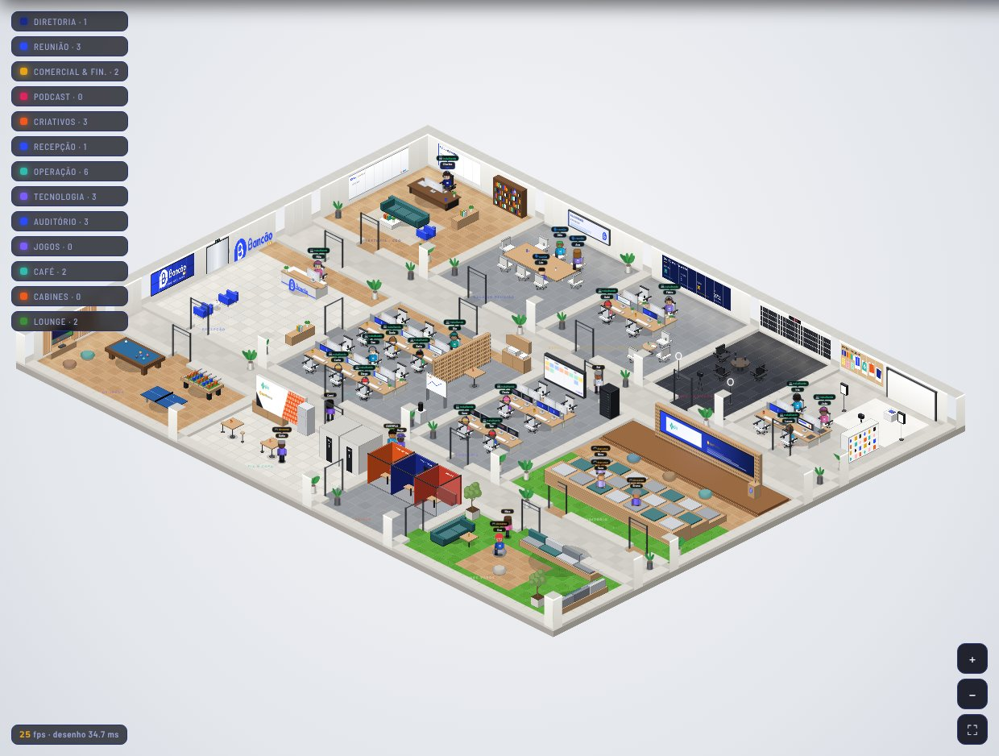
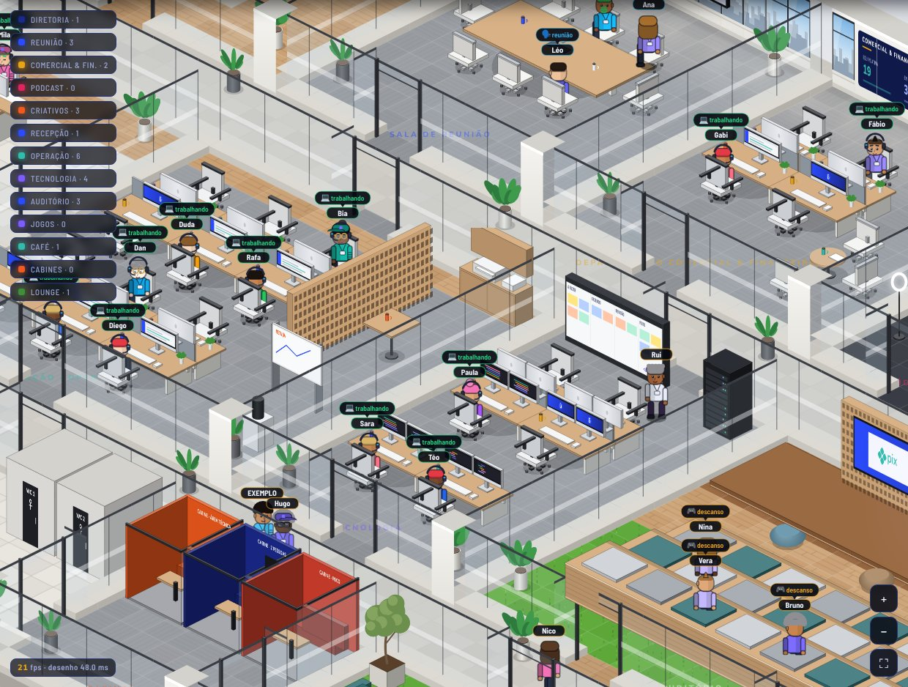

# Bancão SA - Office

O andar do **Bancão SA** num prédio corporativo, no navegador, estilo Habbo.
É a extensão do projeto de arquitetura do escritório (Faria Lima 1748, 1º
andar): mesmos materiais, cores e peças, só que maior. Cada pessoa da equipe
(ou agente de IA) é um boneco com estação própria; clicar no computador dele
abre o sistema daquele agente.



## O andar

| Sala | O que tem |
| --- | --- |
| **Diretoria · CEO** | Mesa do Charles em nogueira, estante, sofá verde-petróleo, poltrona azul, agenda e quadro de ideias na parede |
| **Sala de Reunião** | Mesa de 8 lugares e TV de 75". É aqui que acontece a reunião dos agentes |
| **Departamento Comercial & Financeiro** | 4 estações (Comercial 1 e 2, Financeiro 1 e 2), mesa de apoio, arquivo e painel de metas |
| **Estúdio de Podcast** | Tratamento acústico, letreiro **NO AR**, mesa com 3 microfones, câmera e ring lights (Bancão Cast) |
| **Criativos · Publicidade** | Moodboard com a paleta da marca, 4 estações de criação, fundo infinito, softboxes e câmera |
| **Recepção** | Elevador de entrada, logo Bancão em acrílico com relógio de LED, video wall, balcão e poltronas azuis |
| **Operação · Open Space** | 2 bancadas de 6 lugares, muxarabi de madeira, armário da impressora, mesa alta e quadro móvel |
| **Tecnologia** | Sala menor dos desenvolvedores: 6 estações com monitor duplo (código na tela), rack de servidores e quadro da sprint |
| **Auditório** | Palco com telão de projeção em moldura de muxarabi, arquibancada de 3 níveis com almofadas, puffs e grama sintética |
| **Sala de Jogos** | Sinuca, pebolim, pingue-pongue, videogame com puffs e alvo de dardos |
| **Café Pix & Copa** | Parede Pix · Open Finance com o padrão laranja, bancada de café com espresso, geladeira, mesas altas e banheiros |
| **Cabines** | Três cabines de call e foco: laranja (área técnica), azul (2 pessoas) e vermelha |
| **Lounge Verde** | Grama sintética, deck de madeira, banco com almofadas, sofá verde-petróleo, puffs e oliveiras |

Paredes externas com janelas para a cidade (o céu muda com o horário: dia,
fim de tarde e noite), divisórias de vidro com faixa jateada entre as salas,
piso de madeira, carpete cinza, porcelanato e cimento queimado nos corredores.



## Começar

Precisa do [Node.js](https://nodejs.org) 18 ou mais novo. Nenhuma outra dependência.

```bash
npm start
```

Abra **http://localhost:4321**. O Charles já está na Diretoria e vem um
agente de exemplo para mostrar o fluxo: clique no computador dele e em
**Ligar**.

No Windows, `INICIAR ESCRITORIO.cmd` sobe o escritório e o religa se ele cair;
`CRIAR ATALHO.ps1` cria um atalho na área de trabalho.

## A equipe

Na aba **Contratar**, **+ Cadastrar agente** coloca uma pessoa ou agente novo.
Cada um ganha uma estação fixa escolhida pela função:

- desenvolvimento, QA, dados ou infra vão para **Tecnologia** (T01–T06);
- comercial, vendas ou financeiro, para **Comercial & Financeiro** (F01–F04);
- criação, design, copy, conteúdo ou marketing, para **Criativos** (G01–G04);
- recepção, para o balcão da **Recepção** (R01);
- o resto, para a **Operação** (E01–E12).

Se a sala da função estiver cheia, a pessoa fica com a primeira mesa livre. A
mesa do CEO é só do Charles.

Status de cada boneco:

- **trabalhando**: fica na própria estação;
- **descanso**: vai para sala de jogos, café, lounge verde, auditório, cabines ou podcast, e troca de lugar de tempos em tempos;
- **reunião**: vai para a Sala de Reunião;
- **offline**: sai pelo elevador da recepção.

## Configuração

Copie `data/config.exemplo.json` para `data/config.json`:

- `nome`, `subtitulo`: o topo da tela (padrão: *Bancão SA - Office*);
- `dono`: o nome no boneco da Diretoria (padrão: *Charles*);
- `empresa`: uma frase sobre o negócio, usada como contexto na reunião dos agentes;
- `porta`: a porta do escritório (padrão 4321);
- `reuniao`: horário automático e meta da reunião dos agentes.

O resto (sistemas dos agentes, conversa pelo Claude Code, reunião, avisos no
celular, agenda) funciona igual ao Escritório de Agentes. Os detalhes estão nos
comentários de `server.js` e em `data/sistemas.exemplo.json`.

## Onde mexer

```
js/world.js        planta do andar: salas, portas, pisos, janelas, placas nas paredes
js/furniture.js    mobiliário e lugares (estações, descanso, reunião)
img/               logos do Bancão SA (o Pix é desenhado em vetor no world.js)
css/style.css      tema da interface (azul marinho Bancão)
server.js          servidor: arquivos da tela, API, sobe e vigia os sistemas
```

Para mudar a planta, edite `ROOMS` e `DOORS` em `js/world.js` e os móveis em
`js/furniture.js`. Depois de mexer, confira se todo lugar continua alcançável
a pé: móvel que tapa porta deixa o boneco sem caminho.

## Licença

Uso pessoal permitido. **Proibida a venda, revenda ou redistribuição** (inclusive com outra marca). Veja [LICENSE](LICENSE).
